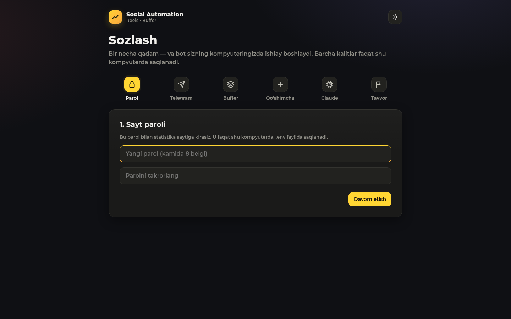
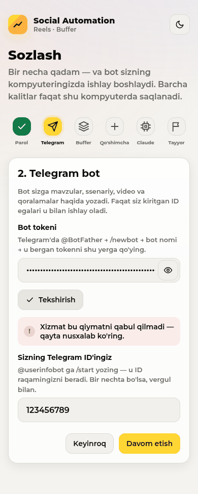
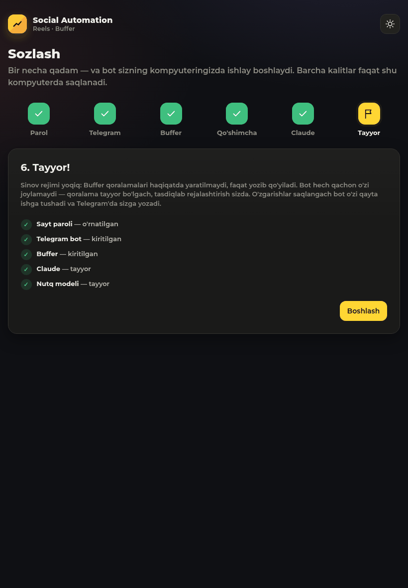

# Social Automation

[O'zbekcha](#ozbekcha) · [English](#english)

---

## O'zbekcha

Bitta Telegram bot **sizning o'z ovozingiz** bilan **suv va oqova suv** mavzusida qisqa vertikal reellar tayyorlaydi
(o'zbek tilida), har bir qadamda sizdan tasdiq so'raydi va tasdiqlangan reelni Instagram, YouTube va LinkedIn uchun
**Buffer qoralamasi** qilib qo'yadi. Shu kompyuterdagi sayt jonli statistika va ish jarayonini ko'rsatadi.
Hammasi **sizning kompyuteringizda** ishlaydi; kalitlar faqat shu yerda saqlanadi.

**Ikki asosiy qonun** ([CLAUDE.md](CLAUDE.md), 15 va 16):
- bot **hech qachon o'zi joylamaydi va rejalashtirmaydi** — faqat Buffer qoralamasi va story qoralamasini tayyorlaydi;
  Buffer'da tasdiqlab rejalashtirish va story'ni joylash sizda;
- bot **muqova yasamaydi** — muqovani sizdan so'raydi va o'zgartirmasdan ishlatadi.

### Kerak bo'ladi
- Linux, macOS yoki Windows 10/11; 8 GB operativ xotira; ~3 GB bo'sh joy.
- Python 3.11+, Node.js 18+, ffmpeg — o'rnatuvchi tekshiradi va qanday o'rnatishni aytadi (macOS'da Homebrew,
  Windows'da winget bilan o'zi o'rnatadi).
- **Claude Code** va o'z Claude akkauntingiz (Pro/Max obunasi). API kalit kerak emas.
- Telegram bot tokeni (@BotFather), Buffer akkaunti (bepul tarif ham bo'ladi).

### O'rnatish — bitta buyruq

**Linux / macOS**
```bash
git clone git@github.com:Abdurahman0/social-automation.git
cd social-automation
./install.sh
```

**Windows** (PowerShell)
```powershell
git clone git@github.com:Abdurahman0/social-automation.git
cd social-automation
powershell -ExecutionPolicy Bypass -File install.ps1
```

O'rnatuvchi: Python muhitini (`.venv`) va paketlarni, Remotion (video chizuvchi) va uning brauzerini, o'zbekcha nutq
modelini (rubaiSTT, ~800 MB, checksum bilan) o'rnatadi; fon xizmatini ro'yxatdan o'tkazadi (Linux: systemd, macOS:
launchd, Windows: Task Scheduler) va brauzerda **http://localhost:8090/setup** sahifasini ochadi.

### Sozlash sahifasi
Birinchi ochilganda sayt sizni **Sozlash** sahifasiga olib boradi: 1) sayt paroli, 2) Telegram bot tokeni va ID'ingiz
(«Tekshirish» botning nomini ko'rsatadi), 3) Buffer kaliti (ulangan kanallarni ko'rsatadi), 4) ixtiyoriy kalitlar
(Meta, Pexels, Pixabay), 5) Claude va nutq modeli holati, 6) yakun. Kalitlar `.env` faylida faqat sizga ochiq holda
saqlanadi va hech qachon to'liq ko'rsatilmaydi. Keyin istalgan qiymatni **Sozlamalar** sahifasida o'zgartirasiz — bot
o'zi qayta ishga tushadi. Parol o'rnatilmaguncha sahifa faqat shu kompyuterning o'zidan ochiladi.

| Kompyuter (qorong'i) | Telefon (yorug') | Planshet |
|---|---|---|
|  |  |  |

Qo'lda sozlash ham mumkin: `.env.example` ni `.env` ga nusxalab to'ldiring (Linux/macOS: `chmod 600 .env`).

### Claude'ga kirish
Terminalda `claude` deb yozing va o'z akkauntingiz bilan kiring (o'rnatilmagan bo'lsa:
`npm install -g @anthropic-ai/claude-code`). Ssenariylar shu login orqali yoziladi. Agar Claude o'rnatilmagan yoki
kirilmagan bo'lsa, bot Telegram'da bitta ogohlantirish yuboradi va kutadi — hech narsa buzilmaydi.

### Yangilash
```bash
git pull
./install.sh            # Windows: powershell -ExecutionPolicy Bypass -File install.ps1
```

### O'chirish
```bash
./install.sh --uninstall        # Windows: install.ps1 -Uninstall
```
Fon xizmatlari o'chiriladi; papka, `.env` va ma'lumotlar qoladi (to'liq o'chirish uchun papkani o'chiring).

### Xavfsizlik
- **Sinov rejimi** (`dry_run = true`) har bir yangi o'rnatishda yoqiq: Buffer qoralamalari ham haqiqatda yaratilmaydi,
  faqat `data/dryrun_posts.json` ga yoziladi. O'chirish: `config.toml` → `dry_run = false`.
- Bot joylash, yuklash yoki rejalashtirish kodiga ega emas (himoya testi `tests/test_guards.py`).
- Sir kalitlar faqat `.env` va `secrets/` da (git'ga tushmaydi), loglarga yozilmaydi.

Egasining qadamlari: [docs/OWNER_TODO.md](docs/OWNER_TODO.md) · qarorlar: [docs/DECISIONS.md](docs/DECISIONS.md)

---

## English

One Telegram bot that makes short vertical reels **with your own voice** about **water and wastewater** (in Uzbek),
asks you at every step, and prepares each approved reel as **Buffer drafts** for Instagram, YouTube and LinkedIn. A
local website shows live statistics and the pipeline. Everything runs **on your own computer**; keys stay there.

**Two laws shape everything** ([CLAUDE.md](CLAUDE.md) 15 and 16): the bot **never publishes or schedules anything**
(Buffer drafts and a story draft only — you approve and schedule in Buffer), and it **never makes a cover** (it asks
for yours and uses it unchanged).

### Requirements
- Linux, macOS or Windows 10/11; 8 GB RAM; ~3 GB free disk.
- Python 3.11+, Node.js 18+, ffmpeg — the installer checks them and tells you how to install them (it installs them
  itself with Homebrew on macOS and winget on Windows).
- **Claude Code** with your own Claude account (Pro/Max). No API key.
- A Telegram bot token (@BotFather) and a Buffer account (the free plan works).

### Install — one command
Linux / macOS: `./install.sh` · Windows: `powershell -ExecutionPolicy Bypass -File install.ps1` (after `git clone`
and `cd social-automation`, see above).

It creates `.venv`, installs the Python and Remotion packages and Remotion's browser, downloads the Uzbek speech
model (rubaiSTT, ~800 MB, checksum-verified), registers the background service (systemd user units on Linux, a
launchd agent on macOS, a Task Scheduler task on Windows) and opens **http://localhost:8090/setup**. Running it again
is safe; it is also the updater. Options: `--no-service`, `--no-open`, `--uninstall` (Windows: `-NoService`,
`-NoOpen`, `-Uninstall`).

### Setup page
On first start every page leads to **Setup**: dashboard password → Telegram token and your user id (with a check that
shows the bot's name) → Buffer key (shows your channels) → optional keys (Meta, Pexels, Pixabay) → Claude and speech
model status → summary. Values are saved to the local `.env` (user-only permissions), shown back only masked, and sent
only to the service they belong to. Change anything later on the **Settings** page; the bot restarts itself. Until a
password exists, Setup only opens from this computer. The manual alternative is `.env.example` → `.env`.

### Claude login
Type `claude` in a terminal and log in with your own account (`npm install -g @anthropic-ai/claude-code` if it is
missing). If Claude is missing or logged out, the bot sends one Telegram alert and waits; nothing crashes.

### Update / uninstall
`git pull && ./install.sh` · `./install.sh --uninstall` (your folder, `.env` and data are kept).

### Telegram commands
`/new [topic]` start now · `/queue`, `/status` · `/stats` · `/pause`, `/resume` · `/lessons`, `/usage`.
Terminal: `.venv/bin/python -m socialauto check` shows what is configured and what is missing (no secrets printed).

### Layout
```
install.sh install.ps1                           one-command installers (scripts/windows_service.ps1: Windows keep-alive)
socialauto/
  workflow.py                                    the flow (research → … → Buffer drafts → story draft)
  reel/      research writer script broll align layout render checklist publish buffer naming state
  platforms/ youtube.py instagram.py             READ-ONLY statistics clients; tunnel.py dryrun.py
  runner.py                                      bot service: waits for the token, restarts on .env change, Claude alert
  env_store.py web/setup.py                      the Setup page's .env store and checks
  voice.py video/ analytics/                     owner voice, ffmpeg helpers, statistics
  web/  server.py static/                        the website (no build step)
remotion/                                        the Remotion composition
tests/                                           pytest (incl. tests/test_guards.py — laws 15 and 16)
```

### Development
```bash
.venv/bin/pip install -r requirements-dev.txt
.venv/bin/pytest -q            # on Linux wrap heavy runs: systemd-run --user --scope -q -p MemoryMax=3G -- …
```
