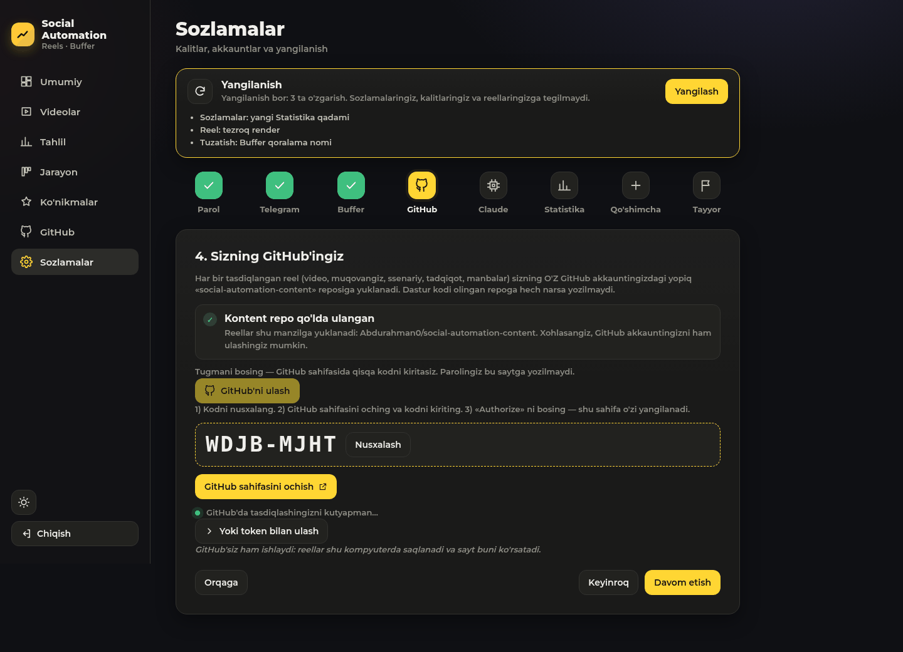
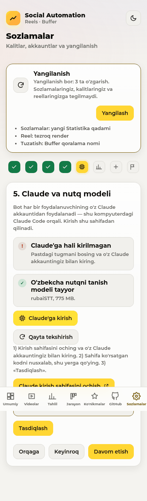
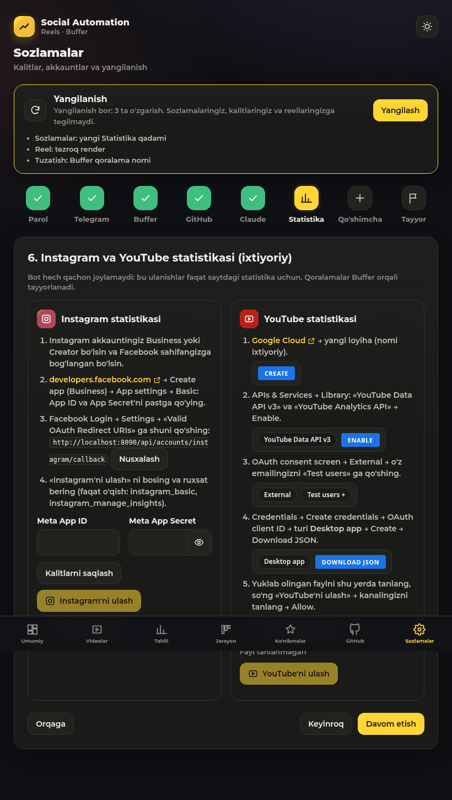

# Social Automation

[O'zbekcha](#ozbekcha) · [English](#english)

### O'rnatish — bitta qator / Install — one line

**Windows** (PowerShell'ni oching / open PowerShell):
```powershell
irm https://raw.githubusercontent.com/Abdurahman0/social-automation/main/install.ps1 | iex
```

**Linux / macOS** (Terminal):
```bash
curl -fsSL https://raw.githubusercontent.com/Abdurahman0/social-automation/main/install.sh | bash
```

GitHub akkaunti ham, parol ham kerak emas: repo ochiq, kod ochiq HTTPS orqali `~/social-automation`
(Windows: `%USERPROFILE%\social-automation`) papkasiga yuklanadi; kerak bo'lsa Git o'zi o'rnatiladi. Keyin brauzerda
Sozlash sahifasi ochiladi. / No GitHub account and no password needed: the repo is public; the code is cloned over
public HTTPS into `~/social-automation` (Windows: `%USERPROFILE%\social-automation`), Git is installed if missing,
then the Setup page opens in your browser.

---

## O'zbekcha

> **Bu repoga faqat egasi yozadi.** O'zingizniki uchun fork qilishingiz shart emas — o'rnating va o'z GitHub'ingizni
> ulang. Ilova bu repodan faqat yangilanish oladi; sizning reellaringiz sizning o'z GitHub'ingizga boradi.

Bitta Telegram bot **sizning o'z ovozingiz** bilan **suv va oqova suv** mavzusida qisqa vertikal reellar tayyorlaydi
(o'zbek tilida), har bir qadamda sizdan tasdiq so'raydi va tasdiqlangan reelni Instagram, YouTube va LinkedIn uchun
**Buffer navbatiga** qo'shadi; Buffer uni o'z jadvali bo'yicha o'zi joylaydi. Shu kompyuterdagi sayt jonli statistika va ish jarayonini ko'rsatadi.
Hammasi **sizning kompyuteringizda** ishlaydi; kalitlar faqat shu yerda saqlanadi.

**Ikki asosiy qonun** ([CLAUDE.md](CLAUDE.md), 15 va 16):
- Telegram'da tasdiqlagan reelingiz **Buffer navbatiga** tushadi va Buffer uni har bir kanal jadvalidagi navbatdagi
  bo'sh vaqtda joylaydi; bot vaqtni o'zi tanlamaydi va tarmoqlarga to'g'ridan-to'g'ri joylamaydi; story Buffer'da
  qoralama bo'lib qoladi, uni o'zingiz joylaysiz;
- bot **muqova yasamaydi** — muqovani sizdan so'raydi va o'zgartirmasdan ishlatadi.

### Kerak bo'ladi
- Linux, macOS yoki Windows 10/11; 8 GB operativ xotira; ~3 GB bo'sh joy.
- Python 3.11+, Node.js 18+, ffmpeg — o'rnatuvchi tekshiradi va qanday o'rnatishni aytadi (macOS'da Homebrew,
  Windows'da winget bilan o'zi o'rnatadi).
- **Claude Code** va o'z Claude akkauntingiz (Pro/Max obunasi). API kalit kerak emas.
- Telegram bot tokeni (@BotFather), Buffer akkaunti (bepul tarif ham bo'ladi).

### O'rnatish — bitta buyruq

**Linux / macOS**
```bash
git clone https://github.com/Abdurahman0/social-automation.git
cd social-automation
./install.sh
```

**Windows** (PowerShell)
```powershell
git clone https://github.com/Abdurahman0/social-automation.git
cd social-automation
powershell -ExecutionPolicy Bypass -File install.ps1
```

O'rnatuvchi: Python muhitini (`.venv`) va paketlarni, Remotion (video chizuvchi) va uning brauzerini, o'zbekcha nutq
modelini (rubaiSTT, ~800 MB, checksum bilan) o'rnatadi; fon xizmatini ro'yxatdan o'tkazadi (Linux: systemd, macOS:
launchd, Windows: Task Scheduler) va brauzerda **http://localhost:8090/setup** sahifasini ochadi.

### Sozlash sahifasi — hammasi saytning ichida, hammasi sizniki
Birinchi ochilganda sayt sizni **Sozlash** sahifasiga olib boradi:
1. sayt paroli;
2. Telegram bot tokeni va ID'ingiz («Tekshirish» botning nomini ko'rsatadi);
3. **Buffer** kaliti — sizning Buffer'ingizga ulangan Instagram, YouTube, LinkedIn kanallari nomi va rasmi bilan
   ko'rinadi (tasdiqlangan reellar shularga navbatga qo'yiladi);
4. **GitHub** — «GitHub'ni ulash»: sayt qisqa kod ko'rsatadi, siz github.com/login/device'da kiritasiz (parol bu
   saytga yozilmaydi). Reellar sizning akkauntingizdagi yopiq `social-automation-content` reposiga yuklanadi (ilova
   uni o'zi yaratadi). Muqobil: faqat shu repo uchun «Contents: read and write» huquqli fine-grained token;
5. **Claude** — «Claude'ga kirish»: o'z Claude akkauntingiz bilan kirasiz, sahifa bergan kodni qo'yasiz. API kalit yo'q;
6. **Statistika** (ixtiyoriy) — Instagram (o'z Meta ilovangiz bilan) va YouTube (o'z Google OAuth mijozingiz bilan,
   faqat o'qish) ulanishi, qadamma-qadam ko'rsatma bilan;
7. ixtiyoriy Pexels / Pixabay kalitlari; 8. yakun.

Kalitlar va tokenlar faqat shu kompyuterda (`.env`, `secrets/`, faqat sizga ochiq), hech qachon to'liq ko'rsatilmaydi,
git'ga va loglarga tushmaydi. Keyin istalgan qiymatni **Sozlamalar** sahifasida o'zgartirasiz — bot o'zi qayta ishga
tushadi. Parol o'rnatilmaguncha sahifa faqat shu kompyuterning o'zidan ochiladi.

| GitHub ulash (kompyuter) | Claude'ga kirish (telefon) | Statistika (planshet) |
|---|---|---|
|  |  |  |

| Kompyuter (qorong'i) | Telefon (yorug') | Planshet |
|---|---|---|
|  |  |  |

Qo'lda sozlash ham mumkin: `.env.example` ni `.env` ga nusxalab to'ldiring (Linux/macOS: `chmod 600 .env`).

### Claude'ga kirish
Sozlamalar → Claude → «Claude'ga kirish» (yoki terminalda `claude`). O'rnatilmagan bo'lsa:
`npm install -g @anthropic-ai/claude-code`. Ssenariylar shu login orqali yoziladi. Agar Claude o'rnatilmagan yoki
kirilmagan bo'lsa, bot Telegram'da bitta ogohlantirish yuboradi va kutadi — hech narsa buzilmaydi.

### Har doim ishlaydi
Kompyuter yonganda bot va sayt o'zi ishga tushadi (Linux: systemd + linger — hatto kirmasdan oldin; macOS: kirganda;
Windows: administrator sifatida o'rnatilsa yonganda, aks holda kirganda). Internet bo'lmasa sayt «Internet yo'q —
kutyapman» deydi, bot jim kutadi va ulanish tiklanishi bilan davom etadi.

### Yangilash
Sozlamalar sahifasida egasi yangi versiya chiqarsa «Yangilanish bor» ko'rinadi — bitta «Yangilash» tugmasi (faqat
fast-forward; `.env`, `secrets/`, `data/`, `config.local.toml` va kontent reposiga tegilmaydi; xizmat o'zi qayta
ishga tushadi). Qo'lda:
```bash
git pull --ff-only
./install.sh            # Windows: powershell -ExecutionPolicy Bypass -File install.ps1
```

### O'chirish
```bash
./install.sh --uninstall        # Windows: install.ps1 -Uninstall
```
Fon xizmatlari o'chiriladi; papka, `.env` va ma'lumotlar qoladi (to'liq o'chirish uchun papkani o'chiring).

### Xavfsizlik
- **Sinov rejimi** (`dry_run = true`) har bir yangi o'rnatishda yoqiq: Buffer'ga hech narsa yuborilmaydi,
  faqat `data/dryrun_posts.json` ga yoziladi. O'chirish: `python -m socialauto dry-run off`, keyin bot va saytni qayta
  ishga tushiring (sozlama `config.local.toml` ga yoziladi; u sizniki, git'ga tushmaydi).
- Reellar dastur kodi reposiga **hech qachon** yozilmaydi (himoya testi `tests/test_content_repo.py`).
- Bot tarmoqlarga to'g'ridan-to'g'ri yuklash/joylash kodiga ega emas va vaqtni o'zi tanlamaydi (himoya testi `tests/test_guards.py`).
- Sir kalitlar faqat `.env` va `secrets/` da (git'ga tushmaydi), loglarga yozilmaydi.

Egasining qadamlari: [docs/OWNER_TODO.md](docs/OWNER_TODO.md) · qarorlar: [docs/DECISIONS.md](docs/DECISIONS.md)

---

## English

> **Only the owner writes to this repo.** You don't need to fork it — install it and connect your own GitHub. The app
> only downloads updates from here; your reels go to your own GitHub.

One Telegram bot that makes short vertical reels **with your own voice** about **water and wastewater** (in Uzbek),
asks you at every step, and adds each approved reel to **Buffer's queue** for Instagram, YouTube and LinkedIn; Buffer posts it on its own schedule. A
local website shows live statistics and the pipeline. Everything runs **on your own computer**; keys stay there.

**Two laws shape everything** ([CLAUDE.md](CLAUDE.md) 15 and 16): approved reels go into **Buffer's queue** and
Buffer posts them at each channel's next free time (the bot never picks a time or posts on a platform directly; the story
stays a Buffer draft), and it **never makes a cover** (it asks
for yours and uses it unchanged).

### Requirements
- Linux, macOS or Windows 10/11; 8 GB RAM; ~3 GB free disk.
- Python 3.11+, Node.js 18+, ffmpeg — the installer checks them and tells you how to install them (it installs them
  itself with Homebrew on macOS and winget on Windows).
- **Claude Code** with your own Claude account (Pro/Max). No API key.
- A Telegram bot token (@BotFather) and a Buffer account (the free plan works).

### Install — one command
Linux / macOS: `./install.sh` · Windows: `powershell -ExecutionPolicy Bypass -File install.ps1` (after `git clone`
and `cd social-automation`, see above).

It creates `.venv`, installs the Python and Remotion packages and Remotion's browser, downloads the Uzbek speech
model (rubaiSTT, ~800 MB, checksum-verified), registers the background service (systemd user units on Linux, a
launchd agent on macOS, a Task Scheduler task on Windows) and opens **http://localhost:8090/setup**. Running it again
is safe; it is also the updater. Options: `--no-service`, `--no-open`, `--uninstall` (Windows: `-NoService`,
`-NoOpen`, `-Uninstall`).

### Setup page — everything inside the website, everything yours
On first start every page leads to **Setup**: dashboard password → Telegram token and your user id (with a check that
shows the bot's name) → Buffer key (your Instagram / YouTube / LinkedIn channels with names and pictures) → **GitHub**
(device flow: the page shows a short code you enter at github.com/login/device; reels go to your own private
`social-automation-content` repo, created by the app; or a fine-grained token for that repo only) → **Claude** (log in
to your own Claude account from the page; no API key) → **Statistics**, optional (Instagram with your own Meta app,
YouTube with your own Google OAuth client, read-only) → optional Pexels / Pixabay → summary. Values are saved to the local `.env` (user-only permissions), shown back only masked, and sent
only to the service they belong to. Change anything later on the **Settings** page; the bot restarts itself. Until a
password exists, Setup only opens from this computer. The manual alternative is `.env.example` → `.env`.

### Claude login
Settings → Claude → "Claude'ga kirish" (or type `claude` in a terminal) and log in with your own account (`npm install -g @anthropic-ai/claude-code` if it is
missing). If Claude is missing or logged out, the bot sends one Telegram alert and waits; nothing crashes.

### Always on
Starts when the computer turns on (Linux: systemd user units + linger, even before login; macOS: at login; Windows: at
boot when installed from an administrator PowerShell, otherwise at login). Without internet the site shows
"Internet yo'q — kutyapman" and the bot waits quietly.

### Update / uninstall
Settings shows "Yangilanish bor" when the owner pushed a new version: one button, fast-forward only, never touches
`.env`, `secrets/`, `data/`, `config.local.toml` or your content repo, then restarts the services. By hand:
`git pull --ff-only && ./install.sh`. Uninstall: `./install.sh --uninstall` (your folder, `.env` and data are kept).
Your own settings (for example `dry_run = false`) go to `config.local.toml`, never into `config.toml`.

### Telegram commands
`/new [topic]` start now · `/queue`, `/status` · `/stats` · `/pause`, `/resume` · `/lessons`, `/usage`.
Terminal: `.venv/bin/python -m socialauto check` shows what is configured and what is missing (no secrets printed).

### Layout
```
install.sh install.ps1                           one-command installers (scripts/windows_service.ps1: Windows keep-alive)
socialauto/
  workflow.py                                    the flow (research → … → Buffer queue → story draft)
  reel/      research writer script broll align layout render checklist publish buffer naming state
  platforms/ youtube.py instagram.py             READ-ONLY statistics clients; tunnel.py dryrun.py
  runner.py                                      bot service: waits for the token, restarts on .env change, Claude alert
  env_store.py web/setup.py                      the Setup page's .env store and checks
  content_repo.py                                the user's OWN content repo; refuses any push to the code repo
  github_account.py claude_login.py web/accounts.py   GitHub (device flow), Claude login, Instagram/YouTube logins
  updater.py netcheck.py                         fast-forward-only updates; "Internet yo'q — kutyapman"
  voice.py video/ analytics/                     owner voice, ffmpeg helpers, statistics
  web/  server.py static/                        the website (no build step)
remotion/                                        the Remotion composition
tests/                                           pytest (incl. tests/test_guards.py — laws 15 and 16)
```

### Development
```bash
.venv/bin/pip install -r requirements-dev.txt
.venv/bin/pytest -q            # on Linux wrap heavy runs: systemd-run --user --scope -q -p MemoryMax=3G -- …
```
