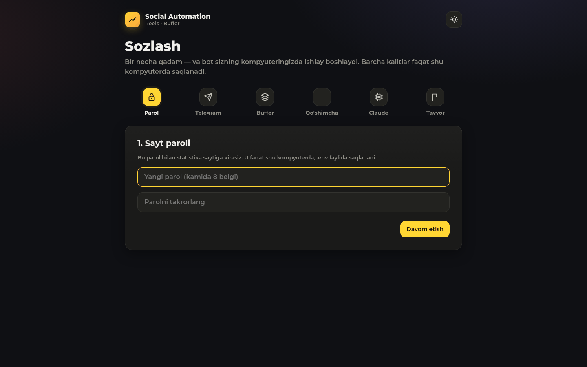
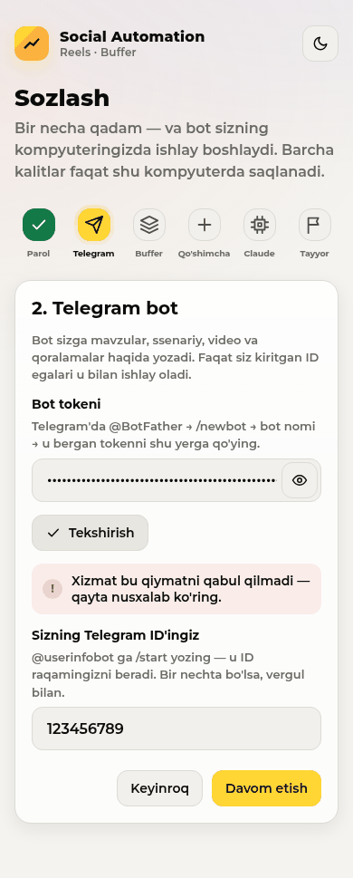
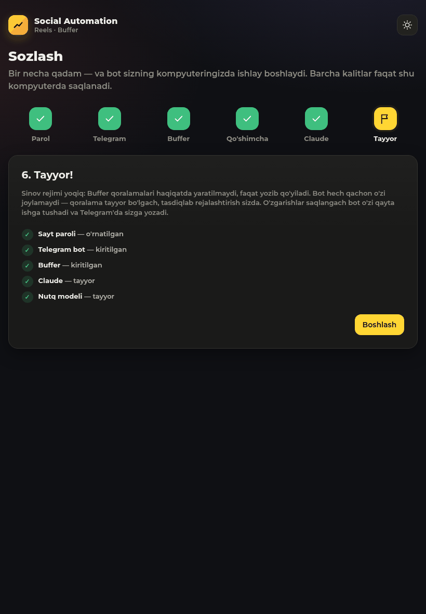

# TASK 06 hisoboti — GitHub va har kimning o'z kompyuterida ishlaydigan ilova (2026-11-08)

## Qisqacha
- **Repo:** https://github.com/Abdurahman0/social-automation — **yopiq (private)**, SSH orqali yuklandi.
  Repo GitHub saytida sizning Chrome profilingiz ("Default", Abdurahman0 sifatida kirilgan) orqali yaratildi:
  README, litsenziya va .gitignore **qo'shilmadi**. Brauzerda boshqa hech narsa qilinmadi; profil nusxasi ishdan keyin
  o'chirildi.
- **GitHub'dagi tarix:** bitta toza boshlang'ich commit (`70ea278`) va undan keyingi kichik commitlar. Eski tarixda
  o'chirilgan joylash (publish) kodi, eski proof fayllari va shaxsiy yo'llar bor edi — shuning uchun u GitHub'ga
  **yuklanmadi**; to'liq eski tarix faqat shu kompyuterdagi `local-history` branchida saqlanadi.
- **Yakuniy yuklangan commit:** hisobot commiti (pastda, «Yuklangan commit» bo'limida).
- **Testlar:** 136 ta test o'tdi — ham shu papkada, ham GitHub'dan yangi klonlangan nusxada (hech biri o'tkazib
  yuborilmadi).
- **Sinov rejimi** (`dry_run = true`) o'zgarmadi va har yangi o'rnatishda yoqiq.

## 1. Sozlash sahifasi (`/setup`)
- Birinchi ishga tushishda (parol yo'q) har qanday sahifa `/setup` ga yo'naltiriladi; API'lar «setup» deb javob beradi.
- Qadamlar (bo'sh doiralar emas, belgili ikonlar): 1) sayt paroli, 2) Telegram tokeni + ID («Tekshirish» `getMe`
  orqali bot nomini ko'rsatadi), 3) Buffer kaliti («Tekshirish» ulangan kanallar nomini ko'rsatadi), 4) ixtiyoriy
  Meta / Pexels / Pixabay, 5) Claude va nutq modeli holati («Qayta tekshirish»), 6) yakun + «Boshlash».
  Har qadamda qiymatni qayerdan olish 1–2 gapda yozilgan.
- Qiymatlar `.env` ga yoziladi: atomar (vaqtinchalik fayl + almashtirish), har biri bitta qator (qiymat yangi qator
  qo'sha olmaydi), Linux/macOS'da `chmod 600`, Windows'da faqat joriy foydalanuvchi huquqi. Sirlar faqat yashirin
  ko'rinadi (`ab••••••yz`) va «O'zgartirish» tugmasi bor; loglarga yozilmaydi; Telegram tokeni faqat
  api.telegram.org'ga, Buffer kaliti faqat Buffer'ga yuboriladi; noto'g'ri ko'rinishdagi token tarmoqqa umuman
  chiqmaydi.
- Parol bo'lmaguncha sahifa faqat shu kompyuterdan ochiladi (127.0.0.1). Proxy yoki tunnel orqali kelgan so'rov
  (`X-Forwarded-For` va h.k.) ham 127.0.0.1 dan keladi — u «tashqi» deb hisoblanadi va rad etiladi.
  Parol o'rnatilgach, Sozlash/Sozlamalar faqat parol bilan.
- **Sozlamalar** sahifasi (menyuda) — istalgan qiymatni, parolni ham, keyin o'zgartirish. `.env` o'zgarsa bot o'zi
  qayta ishga tushadi.
- `.env.example` qo'lda sozlash uchun qoldi (README'da yozilgan).

Skrinshotlar (telefon 390, planshet 820, kompyuter 1440; yorug' va qorong'i; har qadam + Sozlamalar = 42 ta):
`docs/images/setup-<qadam>-<qurilma>-<mavzu>.png`, `docs/images/settings-*.png`. Avtomatik maket tekshiruvi
(gorizontal toshish, ekrandan chiqish, past kontrast, konsol xatolari): **42/42 muammosiz**
(`docs/images/setup_layout_check.json`). Skrinshotlardagi Telegram va Buffer tekshiruvi soxta sinov qiymatlari bilan
qilingan, shuning uchun ular halol «Xizmat bu qiymatni qabul qilmadi» deb ko'rsatadi.

| Parol (kompyuter, qorong'i) | Telegram (telefon, yorug') | Yakun (planshet, qorong'i) |
|---|---|---|
|  |  |  |

## 2. Linux, Windows, macOS
- Shaxsiy yo'llar olib tashlandi: GitHub'dagi barcha fayllarda foydalanuvchi nomingiz ham, uy papkangiz yo'li ham yo'q
  (test `tests/test_install.py` buni har safar tekshiradi). Eski `systemd/` shablonlari va `install_services.sh`
  o'chirildi — xizmat fayllarini endi o'rnatuvchi papkaning o'z yo'li bilan yaratadi.
- Fon xizmati: Linux — systemd user (`Restart=always`), macOS — launchd agent (`KeepAlive`), Windows — Task Scheduler
  (kirishda) + `scripts/windows_service.ps1` qayta ishga tushirish sikli. Hammasi `--uninstall` / `-Uninstall` bilan
  o'chiriladi.
- Windows nomlari: `remotion.cmd`, `cloudflared.exe`; Claude CLI `shutil.which` bilan topiladi (`claude.cmd`).
- Xotira cheklovi (`systemd-run … MemoryMax`) faqat Linux'da, bor bo'lsa; boshqa tizimlarda mavjud past-xotira
  sozlamalari (ffmpeg 2 oqim, Remotion bitta tab) ishlaydi.
- Bot: token yo'q bo'lsa endi chiqib ketmaydi — `.env` ni har 5 soniyada tekshirib kutadi. `.env` o'zgarsa toza
  to'xtab, 75 kodi bilan chiqadi va xizmat boshqaruvchisi uni yangi qiymatlar bilan qayta ishga tushiradi.
  Claude o'rnatilmagan yoki kirilmagan bo'lsa — Telegram'da **bitta** ogohlantirish (Claude ishlagandan keyingina
  yana), har 30 daqiqada qayta tekshiriladi; ishlar kutadi, hech narsa qulamaydi.

## 3. O'rnatuvchilar
- `./install.sh` (Linux + macOS) va `install.ps1` (Windows): Python 3.11+, ffmpeg, Node 18+ ni tekshiradi (macOS'da
  Homebrew, Windows'da winget bilan o'zi o'rnatadi; Linux'da aniq `apt`/`dnf`/`pacman` buyrug'ini aytadi — skript
  sudo ishlatmaydi), `.venv` + paketlar, Remotion paketlari va brauzeri, nutq modeli, ixtiyoriy cloudflared, `.env`
  (600), Claude holati, fon xizmati, keyin brauzerda `http://localhost:8090/setup` ni ochadi. Har qadam o'zbekcha +
  inglizcha; xatoda nima qilish kerakligi yoziladi, stack trace ko'rsatilmaydi. Qayta ishga tushirish xavfsiz —
  `git pull` dan keyin yangilovchi ham shu.
- Nutq modeli: `python -m socialauto download-model` — rasmiy Hugging Face repodan progress bar bilan yuklaydi va
  har bir katta faylni repo e'lon qilgan SHA-256 bilan tekshiradi (mos kelmasa fayl o'chiriladi). Hajmi ~775 MB
  (int8 versiya; topshiriqdagi 1.2 GB emas).
- Tekshiruvlar: `shellcheck install.sh` — **xato yo'q**; PowerShell 7.6.9 parser — `install.ps1` va
  `windows_service.ps1` da **0 ta xato**. Ikkalasi ham testlarda (`tests/test_install.py`).

## 4. Claude — har kimning o'z akkaunti
API kalit maydoni hech qayerda yo'q. Sozlash sahifasi va o'rnatuvchi `claude` o'rnatilgan/kirilganini ko'rsatadi va
«terminalda `claude` yozing va o'z akkauntingiz bilan kiring» deb tushuntiradi.

## 5. Mavzu va til
O'zgartirilmadi (suv / oqova suv, o'zbekcha). Promptlarda shaxsiy yo'l yoki sir yo'q.

## 6. GitHub
- `proof/` git kuzatuvidan chiqarildi (`git rm -r --cached proof`, `.gitignore` da `/proof/`), fayllar shu
  kompyuterda qoldi. `data/`, `logs/`, `work/`, `models/`, `secrets/`, `.env`, `bin/` ham GitHub'ga tushmaydi.
  `tests/fixtures/sample_voice_*.wav` — sintetik (espeak/Kokoro) sinov ovozlari, sizning ovozingiz emas.
- **Sir skaneri** (gitleaks 8.26.0, Kali paketidan; GitHub relizlari o'sha payt 504 qaytargani uchun):
  - GitHub'ga yuklangan barcha commitlar: `7 commits scanned … no leaks found`.
  - `local-history` (yuklanmaydi): 1 ta topilma — `tests/test_setup.py` dagi soxta sinov qiymati
    (`buf-secret-key-123`); u toza tarixda `gitleaks:allow` bilan belgilangan.
  - Qo'shimcha `git grep`: Telegram/Anthropic/GitHub/Google/Meta token ko'rinishlari, shaxsiy kalit bloklari — faqat
    log-redaktordagi naqsh (`sk-ant-` regexi) topildi, haqiqiy sir yo'q.
  - O'chirilgan joylash kodi GitHub tarixida yo'q: `post_now`/`publish_direct` faqat hujjatlarda, himoya testida
    va eski bazalardan ustunlarni o'chiradigan migratsiyada uchraydi.
  - Commit muallifi sifatida git sozlamangizdagi ism/email ko'rinadi (bu sizning o'z git identifikatoringiz).
- `CLAUDE.md` 12-qonun (remote bor, `local-history` hech qachon yuklanmaydi) va `docs/DECISIONS.md` (Task 06 bo'limi)
  yangilandi. README: avval o'zbekcha, keyin inglizcha.

## 7. Yangi klon sinovi (shu Linux kompyuterda)
- `git clone git@github.com:Abdurahman0/social-automation.git` → `./install.sh --no-service --no-open`, xotira
  cheklovi ichida. **Eslatma:** bu kompyuterda `/tmp` operativ xotirada (tmpfs, 3.8 GB) — 3 GB lik o'rnatish
  xotirani to'ldirib yuborardi, shuning uchun klon diskdagi `/var/tmp/sa-fresh` ga qilindi.
- Natija: barcha 8 qadam ✓ (Python 3.13, paketlar, Remotion, model yuklandi va checksum to'g'ri, `.env` yaratildi,
  Claude kirilgan). cloudflared o'sha payt GitHub 504 xatosi sabab yuklanmadi — u ixtiyoriy, o'rnatuvchi to'g'ri
  «o'tkazib yuborildi» dedi.
- Qayta ishga tushirish (idempotentlik): model «allaqachon yuklangan va tekshirilgan», `.env` «tegilmadi» — xato yo'q.
- Klonning o'z `.venv` i bilan sayt ishga tushirildi; birinchi kirish `/setup` ga yo'naltirdi; sahifa telefon,
  planshet, kompyuterda, yorug' va qorong'i rejimda to'liq o'tildi (42 skrinshot, maket muammosi yo'q).
- Klon ichida testlar: **136 passed**.

## 8. Sinov paytida topilib tuzatilgan xatolar
- **Buffer noto'g'ri/eskirgan kalitni `UNAUTHENTICATED` deb qaytaradi** — kod buni auth xatosi deb tanimasdi, ya'ni
  «kalit eskirdi» ogohlantirishi sizga kelmasdi. Tuzatildi va test qo'shildi; Sozlash sahifasidagi tekshiruv ham endi
  «internet yo'q» emas, «qabul qilmadi» deydi.
- Sayt ishga tushgandagi parolni eslab qolardi — `.env` tozalansa ham Sozlash sahifasiga qaytmasdi. Endi parol faqat
  `.env` dan (yoki haqiqiy muhit o'zgaruvchisidan) o'qiladi; test qo'shildi.
- Yakun sahifasi tekshirilmagan kalitlarni «tayyor» derdi — endi «kiritilgan» deydi; sinov rejimi matni haqiqiy
  sozlamaga qarab chiqadi.
- Reel'ni GitHub'ga yuklab bo'lmasa saytda xom git xabari chiqardi — endi oddiy o'zbekcha izoh, tafsilot logda.
- Telefonda tugmalar qatori, «Qo'shimcha» yorlig'i va eski «YouTube + Instagram» yozuvi tuzatildi.

## 9. Shu kompyuterda holat
- `./install.sh` sizning papkangizda ham ishga tushirildi: sayt va bot xizmati **faol**; bot loglarda «Waiting for the
  Telegram token» — tokenni saytdagi **Sozlamalar → Telegram** ga kiritishingiz bilan o'zi ishga tushadi.
  `dry_run = true`.
- Topshiriq ishlari paytida (Task 05 birlashtirilganda) xato bilan commit qilingan symlinklar `.venv`, `bin`, `models`,
  `remotion/node_modules` papkalarini o'chirib yuborgan edi. Hammasi qayta tiklandi (venv, Remotion, brauzer,
  model — checksum to'g'ri, cloudflared, git-lfs); ma'lumotlar bazasi va `data/` zarar ko'rmadi. `.gitignore` tuzatildi,
  saboq yozib qo'yildi.

## 10. Bu yerda tekshirib bo'lmaganlar (ochiq aytaman)
- **Windows va macOS** bu kompyuterda ishga tushirib ko'rilmadi. Ular faqat statik tekshirildi: PowerShell parser
  (0 xato), shellcheck (xato yo'q, macOS shoxobchasi ham shu skriptda), Windows binar nomlari uchun testlar. Birinchi
  haqiqiy Windows/macOS o'rnatishda muammo chiqsa, xabarini yuboring.
- Haqiqiy Telegram tokeni va Buffer kaliti hali yo'q, shuning uchun «Tekshirish» tugmalarining muvaffaqiyatli javobi
  (bot nomi, kanal nomlari) faqat testlarda soxta javob bilan tekshirilgan.

## Yuklangan commit
Ushbu hisobot va skrinshotlar bilan oxirgi commit — `git log -1 origin/main` (hash pastdagi xulosada ham aytiladi).
