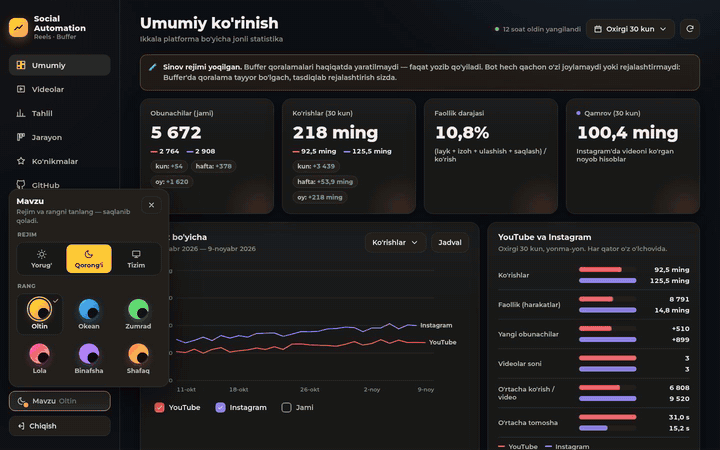
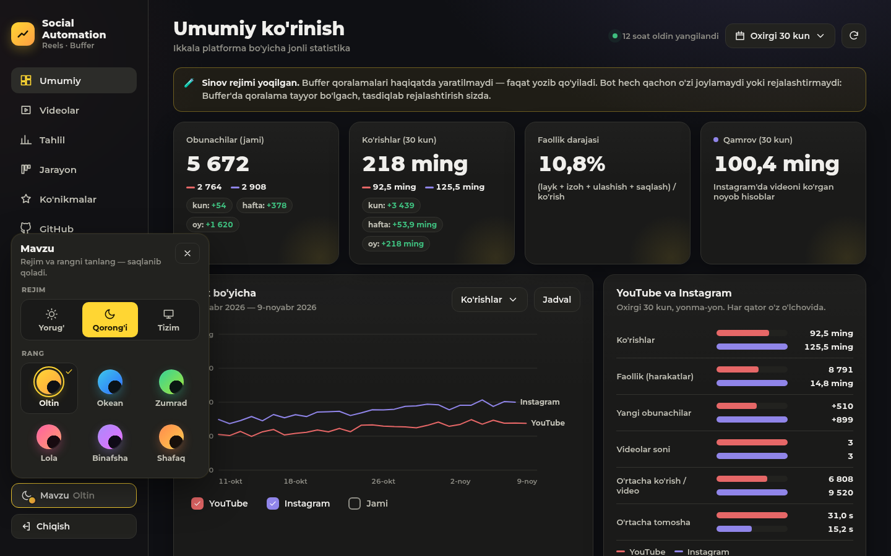
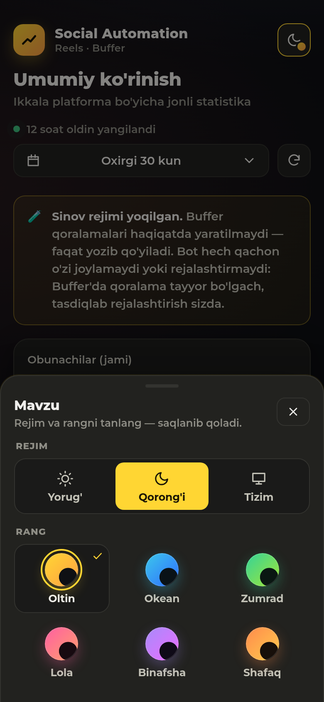
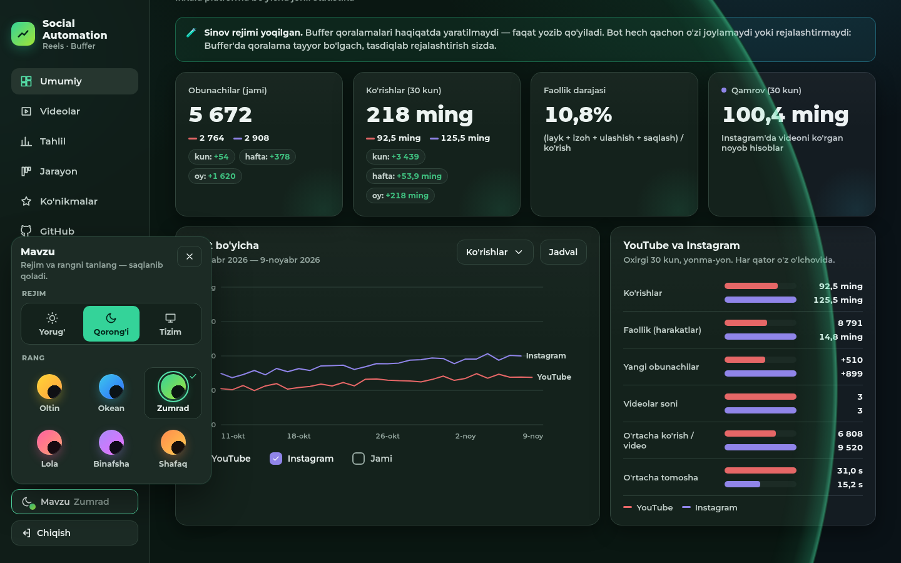
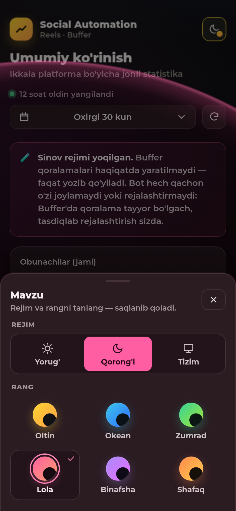
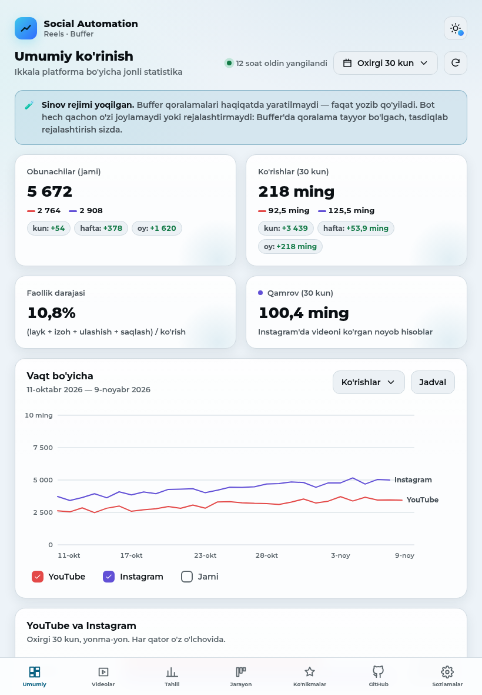
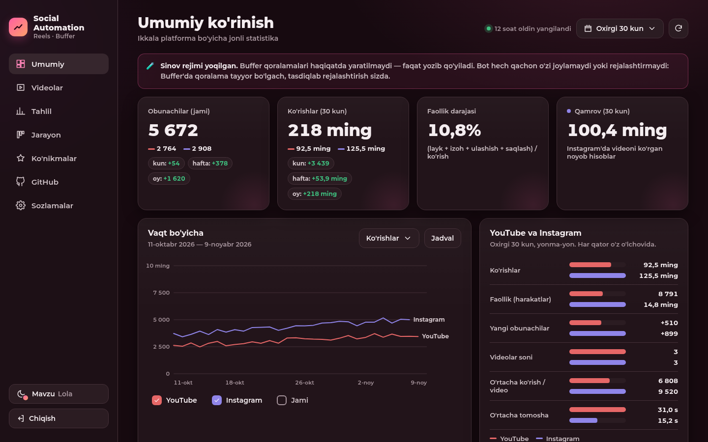

# TASK 08 hisoboti — rang mavzulari va tugmadan boshlanadigan to'lqin (2026-11-09)

Sizdan hech narsa kerak emas: bu vazifada siz bajaradigan qadam yo'q.

## 1. Nima o'zgardi
- **Rejim va rang endi alohida.** Rejim: **Yorug'**, **Qorong'i** yoki **Tizim** (kompyuter/telefon sozlamasiga
  ergashadi). Rang: **Oltin** (avvalgi sariq, standart), **Okean** (ko'k/feruza), **Zumrad** (yashil), **Lola**
  (pushti), **Binafsha**, **Shafaq** (to'q sariq, quyosh botishi). Har bir rang ikkala rejimda ham ishlaydi, ya'ni
  jami 12 ta ko'rinish.
- Har bir rang faqat tugmalarni emas, **butun saytni** bo'yaydi: fon, kartalar, chiziqlar, matn, ogohlantirish
  bloki, yon panel, pastki menyu, soyalar va logotip.
- **YouTube (qizil) va Instagram (binafsha)** chiziqlari hamma ranglarda bir xil qoladi, shuning uchun grafikda
  ularni doim taniysiz.
- Barcha 12 ko'rinishda matn o'qilishi WCAG AA talabiga mos (matn kamida 4.5:1, grafik chiziqlar kamida 3:1).
  Buni test CSS ranglaridan o'zi hisoblab tekshiradi.

## 2. Qanday ishlatiladi
- Kompyuterda: chap panelning pastidagi **«Mavzu»** tugmasi. Planshet va telefonda: yuqori o'ng burchakdagi
  oy/quyosh tugmasi. Kirish sahifasida va birinchi «Sozlash» sahifasida ham bor.
- Tugma kichik oyna ochadi: tepada rejim (quyosh / oy / monitor), pastda 6 ta rang doirasi. Tanlangan rangda
  belgi (✓) turadi. Telefonda bu oyna pastdan chiqadi.
- Rangni yoki rejimni bosing — yangi mavzu **aynan siz bosgan doiradan to'lqin bo'lib** butun ekranga yoyiladi.
  To'lqin chetida yangi rangda yupqa yorug' halqa yuradi. Oyna ochiq qoladi, boshqasini ham sinab ko'rishingiz mumkin.
- Klaviatura: Tab bilan o'tish, strelkalar bilan tanlov ichida yurish, Enter bilan tanlash. Esc oynani yopadi,
  kursor yana «Mavzu» tugmasiga qaytadi.
- Tanlov shu brauzerda saqlanadi. Sahifa yangilanganda noto'g'ri rang bir lahza ham ko'rinmaydi.
  «Tizim» rejimida telefon yoki kompyuter kunduzgi/tungi rejimga o'tsa, sayt ham darhol o'tadi.

| Kompyuter: mavzu oynasi | Telefon: pastdan chiqadigan oyna |
|---|---|
|  |  |

| To'lqin o'rtasida (kompyuter, Zumrad) | To'lqin o'rtasida (telefon, Lola) |
|---|---|
|  |  |

| Okean, yorug' (planshet) | Lola, qorong'i (kompyuter) |
|---|---|
|  |  |

## 3. Nozik joylar ham hal qilindi
- To'lqin paytida yana bossangiz, birinchi to'lqin darhol tugaydi va yangisi siz bosgan yangi joydan boshlanadi.
  Chrome to'lqin paytida bosishni sahifaning o'ziga yuboradi va oyna yopilib qolardi. Shuni topib tuzatdim.
- Grafiklar sahifani qayta chizmasdan yangi ranglarga o'tadi. Sahifa joyi (scroll), ochiq oyna, yuqoridagi va
  pastki menyular joyida qoladi. To'lqin paytida gorizontal scroll paydo bo'lmaydi.
- Eski brauzerlarda (Firefox, eski Safari) View Transitions yo'q. U yerda ham yangi fon rangidagi doira xuddi shu
  nuqtadan o'sadi, keyin yumshoq yo'qoladi. Sakrash yoki miltillash bo'lmaydi.
- Tizimda «harakatni kamaytirish» yoqilgan bo'lsa, to'lqin chiqmaydi. Ranglar qisqa va silliq almashadi.

## 4. Tekshiruv
- `tests/test_themes.py` (20 ta test): 6 rang × 2 rejimning hammasida ranglar to'liqligi va kontrast tekshiriladi.
  Saqlash va «Tizim» rejimini tekshirish uchun `<head>` dagi haqiqiy skript Node'da ishga tushiriladi. Rang
  ro'yxati hamma joyda bir xilligi ham tekshiriladi. Butun to'plam: **179 passed**.
- `scripts/theme_check.py` haqiqiy saytda Chrome bilan ishlaydi (xotira chegarasi 3G). U **56 ta tekshiruv**
  bajaradi, hammasi **OK**:
  - 6 rang × 2 rejimdagi bosh sahifa telefon (390), planshet (820) va kompyuterda (1440) tekshirildi. Hammasida
    gorizontal toshish ham, konsol xatosi ham yo'q.
  - To'lqin o'rtasidagi kadr kompyuterda va telefonda olindi. Doira markazi bosilgan doira/ikonka markazi bilan
    pikselgacha aniq mos keldi.
  - Klaviatura, sahifa yangilangandan keyin saqlanish va «Tizim» (OS o'zgarishi) ham tekshirildi.
  - Ikki marta tez bosish, «harakatni kamaytirish» rejimi va View Transitions'siz zaxira yo'l tekshirildi.
  - Grafik rangi almashishi va scroll joyida qolishi ham tekshirildi.
  - Kirish sahifasi hamda birinchi «Sozlash» sahifasidagi tanlagich uchala ekranda tekshirildi.
- Eski sahifalarning umumiy tekshiruvi (`scripts/screenshots.py`) ham qayta o'tdi: **all OK**.
- Barcha skrinshotlar `/tmp/social_task08/` da (36 ta rang × rejim × qurilma kadri, to'lqin kadrlari va boshqalar). Eng yaxshi 6 tasi
  va GIF `docs/images/task08-*` da.

## 5. Tekshirib bo'lmagan narsalar
- **Haqiqiy Firefox va Safari**: bu kompyuterda faqat Chrome bor. Zaxira yo'l Chrome'da View Transitions'ni
  o'chirib sinaldi va ishladi, lekin haqiqiy Firefox/Safari'da ko'rilmadi.
- **Haqiqiy telefon**: telefon Chrome emulyatsiyasida sinaldi (390 px, sensorli ekran). Haqiqiy iPhone/Android'da
  sinalmadi.
- **GIF** brauzerning o'z yozuvi emas. U to'lqinni har 36 ms da to'xtatib olingan kadrlardan yig'ilgan. Jonli
  harakat undan biroz silliqroq ko'rinadi.
