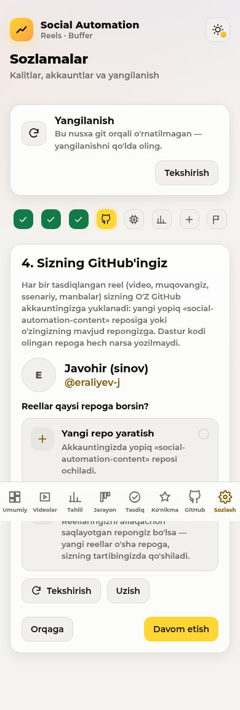
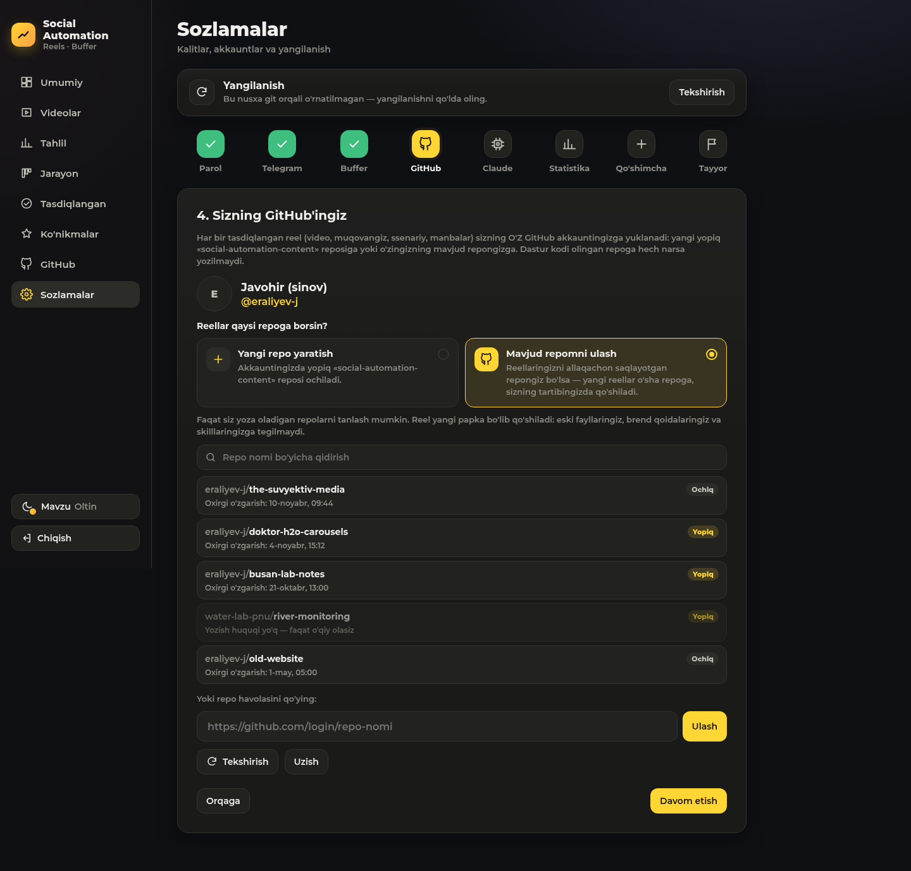
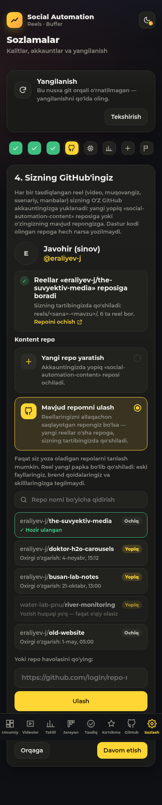
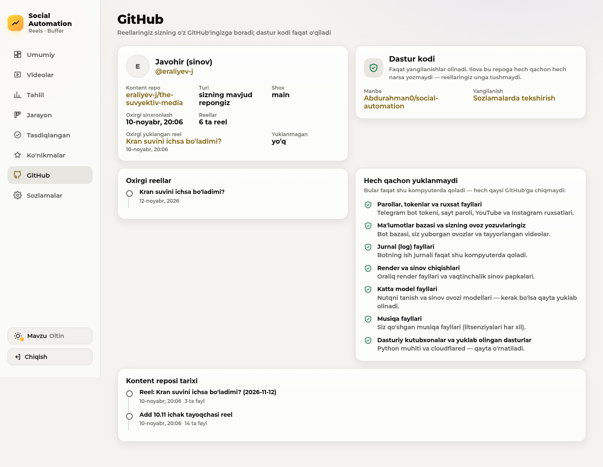

# Task 09 — Javohirning mavjud reposini ulash (hisobot)

## 0. Repo o'rganildi (faqat o'qish uchun klon, `/var/tmp`)

`github.com/eraliyev-j/the-suvyektiv-media` (ochiq, ~630 MB, 104 commit, `main`). Unga hech narsa yozilmadi:
klonning push manzili o'chirildi, testlar faqat lokal bare nusxalarda ishlaydi.

| Narsa | Topilgani |
|---|---|
| Reel papkalari | `reels/<YYYY-MM-DD>-<mavzu>/` — 17 ta (`2026-09-17-welcome` … `2026-11-10-ichak-tayoqchasi`) |
| Fayl nomlari | `reel.mp4`, `cover.jpg`, `script.md`; ba'zan `reel_en.mp4`, `reel_b.mp4`, `cover_grid.jpg`, `src/*.py`, `*.srt` |
| Katta fayllar | mp4 lar (50–70 MB gacha) **to'g'ridan-to'g'ri** commit qilingan. Git LFS yo'q (`.gitattributes` yo'q) |
| `script.md` | `# Sarlavha`, reja qatori, `## Ovoz matni` (`1. (5.5 s) matn` — soniyalar bilan), `## Raqamlar va manbalar` / `## Manbalar`, `## Caption (taklif)` |
| `posted.md` | Sarlavha `YYYY-MM-DD \| pillar \| topic \| hook \| CTA#`; reel qatorlarida pillar = `REEL`, CTA = `-` |
| Brend qoidalari | `brand/voice.md` (reel 30–40 s, **maks. 45 s**, raqam faqat manbadan, CTA ≤ 4 s, imzo «Doktor H₂O · Javohir»), `guidance-book.md` (montaj uslubi), `brand/voice-template.md` (shablon) |
| Skilllar | `.claude/skills/`: `doktor-h2o-workflow`, `doktor-h2o-brand`, `ig-*` paketi (MIT), `effects`, `video-montaj` |
| Boshqalar | `posts/` (karusellar, `slides.json`), `tools/`, `audits/2026-10-27.md`, `audits/2026-10-28.md` |
| Commitlar | Javohir o'z kompyuteridan va Claude Code orqali yozadi (`Add 10.11 … reel`), ya'ni repo biz ishlayotganda ham oldinga ketadi |

## Qarorlar (kod uchun)

- **Klon, init emas.** Mavjud repo tanlansa `content_dir` ga klonlanadi: qisman (`--filter=blob:limit=1m`) va sparse
  (video/audio fayllar diskka tushirilmaydi), chunki repo katta. Tarix to'liq saqlanadi.
- **Uning ustiga, hech qachon ustidan emas.** Har yuklashdan oldin `fetch`, keyin fast-forward yoki `rebase`.
  To'qnashuvda: `rebase --abort`, reel commiti `socialauto/kutilmoqda/<papka>` shoxida qoladi, Telegram'da o'zbekcha
  xabar. `--force` hech qachon yo'q (test bor).
- **Faqat yangi papka + `posted.md`.** Commit faqat aniq yo'llar bilan qilinadi; testda `git diff --name-only`
  bilan tekshiriladi.
- **Uning tartibi.** `reel.mp4` / `cover.jpg` topilsa, yangi reel ham `reel.mp4`, `cover.<asl format>`, `script.md`
  (uning formatida: soniyali ovoz matni, manbalar, caption) bo'ladi. LFS ishlatmagani uchun biz ham ishlatmaymiz
  (GitHub'ning 100 MB chegarasidan oshsa — papka ichidagi `.gitattributes` bilan LFS, ildizga tegilmaydi).
- **`posted.md`** faqat reel haqiqatan Buffer navbatiga qo'shilganda (dry-run emas) uning formatida bitta qator oladi:
  mavzu ustunida «Buffer navbatida», hech qachon «posted» deyilmaydi.
- **Brend:** `brand/*.md` (shablonlarsiz), `guidance-book.md`, brend/workflow skilllari Claude'ga har tadqiqot,
  ssenariy va caption so'rovida beriladi; `voice.md` dagi «maksimum 45 s» ssenariy oynasini 30–45 s qiladi.
  Oldingi reellar va `audits/` mavzu takliflari uchun misol sifatida o'qiladi.

## Bajarildi

| Talab | Qayerda |
|---|---|
| Sozlamalar → GitHub: «Yangi repo yaratish» / «Mavjud repomni ulash», qidiriladigan ro'yxat (nom, Yopiq/Ochiq, Toshkent vaqti), havola maydoni, yozish huquqi yo'q repo sababi bilan | `web/static/app.js` (`repoChooser`, `existingPicker`), `/api/accounts/github/repos`, `/api/accounts/github/choice` |
| Tanlov shu kompyuterda (`config.local.toml`), kod reposi doim rad etiladi | `ContentRepo.choose`, `guard` |
| Repo almashtirish; eski klon o'chirilmaydi (`content-repo.<nom>-<vaqt>`) | `ContentRepo._move_aside` |
| Klon (qisman + sparse, videolarsiz), `git init` emas | `ContentRepo._clone` |
| Har yuklashdan oldin fetch + ff/rebase; rad etilgan push qayta rebase; `--force` yo'q; to'qnashuvda reel `socialauto/kutilmoqda/<papka>` shoxida, Telegram'da o'zbekcha xabar | `sync`, `_push_existing`, `_keep_pending`, `NOTE_CONFLICT` |
| Uning papkasi bilan bir xil nom bo'lsa — `<papka>-2`, fayllari ustiga yozilmaydi | `_free_folder` |
| Uning tartibi (`reel.mp4`, `cover.jpg`, `script.md`), tanilmasa — bizning tartib | `layout`, `reel_files` |
| `script.md` uning formatida (soniyali ovoz matni, manbalar, caption) | `reel/script.py: as_repo_markdown` |
| `posted.md` ga uning formatida qator, faqat Buffer navbatiga haqiqatan qo'shilganda, «Buffer navbatida» | `posted_line`, `append_posted`, `Workflow._posted_md` |
| Brend qoidalari Claude'ga (tadqiqot, ssenariy, caption), 30–45 s oyna, oldingi reellar va audit misol sifatida | `ContentRepo.brand/examples`, `reel/writer.py`, `script.window()` |
| «Ko'nikmalar»da «Kontent reposi» guruhi | `web/skills.py` |
| GitHub sahifasi: repo (havola), shox, oxirgi sinxronlash, «N ta reel», oxirgi yuklangan reel | `ContentRepo.status`, `accountCard` |
| Telegram: «Reel sizning the-suvyektiv-media repongizga yuklandi» + papka havolasi | `telegram_bot.buffer_message`, `reels.git_url` |

**Testlar:** `tests/test_existing_repo.py` (16 ta: tanlov, klon, rebase, rad etilgan push, to'qnashuv, nomlar
to'qnashuvi, uning tartibi, `posted.md` formati va bir vaqtda tahrir, guard, repo almashtirish, brend, skilllar,
butun oqim Telegram'dan uning reposigacha — `git diff --name-only` bilan faqat yangi papka + `posted.md`), API
testlari `tests/test_accounts.py`. Hammasi lokal bare repolarda. To'liq to'plam: **205 passed, 1 skipped**
(skip — `SA_SUV_BARE` berilganda uning haqiqiy tarixidagi test; u alohida ishga tushirildi va o'tdi).

**Haqiqiy tarixda sinov** (uning reposining LOKAL to'liq nusxasi, 104 commit; GitHub'ga hech narsa yozilmadi):
`proof/task09/real_repo_check.txt` — o'zgargan fayllar faqat `posted.md` va `reels/2026-11-12-kran-suvi/{cover.jpg,
reel.mp4,script.md}`; `posted.md` oxirgi qatori: `2026-11-12 | REEL | Kran suvi (Buffer navbatida: Instagram,
YouTube, LinkedIn) | Kran suvini ichsa bo'ladimi? | -`. Ilovaning klon usuli GitHub'dan ~50 MB oladi (630 MB o'rniga).

**Skrinshotlar** (`scripts/content_repo_screenshots.py`, MemoryMax=3G ostida): 66 ta — telefon/planshet/kompyuter,
yorug'/qorong'i, GitHub sahifasi 6 ta palitrada; tartib muammosi yo'q. Tanlanganlari: `docs/images/task09/`.

**Ochiq qolgan (faqat Javohir qiladigan):** o'rnatish va o'z akkauntlarini ulash — `docs/OWNER_TODO.md` §16.
